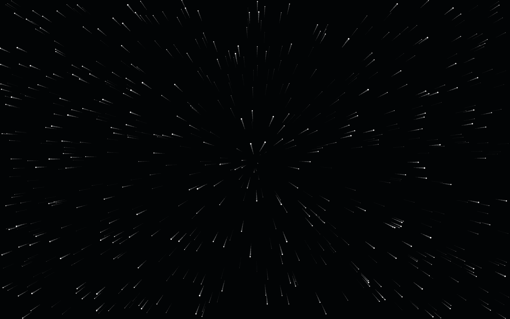

# StarField

A modern version of the screensaver from the 90s: stars stream toward you out
of a near-black sky, brightening and growing as they approach, each with a
short motion-blur tail.

StarField is the animated starfield background from **The Bridge**, extracted
into native screensavers for **macOS** (`StarField.saver`) and **Windows**
(`StarField.scr`). It has the same simulation, the same look and the same
settings as the original, and it needs no browser or web runtime.



## Install

Download the latest build from the
[Releases](https://github.com/DJSethDuncan/StarField/releases) page. Builds
from every push are also attached to the
[Actions](https://github.com/DJSethDuncan/StarField/actions) runs as artifacts.

### macOS (11 Big Sur or later, Apple silicon and Intel)

1. Unzip `StarField-macOS.zip` and double-click **StarField.saver**.
2. macOS asks whether to install it for this user or all users. It then
   opens **System Settings → Screen Saver**, where you can pick StarField.
3. Click **Options…** to change speed, density and the other settings.

The bundle is ad-hoc signed but **not notarized**, so Gatekeeper may say it
"can't be opened" or is "from an unidentified developer". To allow it, use one
of these:

- Open **System Settings → Privacy & Security**, scroll down, and click
  **Open Anyway** next to the StarField message. Or:
- Remove the download quarantine before installing:

  ```bash
  xattr -dr com.apple.quarantine ~/Downloads/StarField.saver
  ```

To uninstall, right-click StarField in Screen Saver settings and choose
**Delete "StarField"**. You can also delete
`~/Library/Screen Savers/StarField.saver`.

### Windows (10 and 11, x64 and ARM64)

Unzip `StarField-Windows-x64.zip` (or `-ARM64` for ARM devices), then use
either method:

- **Right-click `StarField.scr` → Install**. Windows opens Screen Saver
  Settings with StarField selected. Leave the file where it is, because
  Windows runs it from that location.
- **Or use the per-user installer**, which needs no admin rights. It copies the
  file to `%LOCALAPPDATA%\StarField` and makes it your screensaver:

  ```powershell
  powershell -ExecutionPolicy Bypass -File install.ps1
  ```

  Run it again with `-Uninstall` to remove it.

Click **Settings…** in Screen Saver Settings to configure StarField. The
executable is unsigned, so SmartScreen may warn you the first time. Choose
**More info → Run anyway**.

## Settings

These are the same controls as the **Stars** panel in The Bridge, with the
same ranges and defaults:

| Setting | Range | Default | What it does |
| --- | --- | --- | --- |
| Motion | on / off | on | Off draws a still field of dots (no animation, lowest cost). |
| Phase shift | on / off | off | Distance-based tint: distant stars glow red, near stars turn blue, white in between. |
| Speed | 0.025× – 2× | 1× | How fast stars approach. |
| Density | 25% – 1000% | 100% | Multiplies the star count. Higher values cost more CPU/GPU. |
| Star variation | 0% – 100% | 0% | Blends each star's base colour from white toward a real stellar palette (orange, warm white, blue-white). |
| Tail length | 0× – 3× | 1× | Length of the motion trail. 0 disables tails. |

Each platform's dialog has **Reset to defaults**. Settings are stored per
user: on macOS in the screensaver's `ScreenSaverDefaults` domain
(`com.djsethduncan.StarField`), on Windows under
`HKEY_CURRENT_USER\Software\StarField`.

## How it works

```
core/      starfield.c/.h   Platform-neutral C99 engine (simulation, trails, colour, clock, sizing)
macos/     StarFieldView.m  ScreenSaverView subclass + options sheet  → StarField.saver
windows/   starfield_scr.cpp Win32 + Direct2D screensaver + dialog    → StarField.scr
tests/     test_starfield.c Engine tests ported from The Bridge
```

### The engine

`core/starfield.c` is a line-for-line port of The Bridge's
`src/starfield-engine.ts`, and the draw loop in `src/Starfield.tsx`.

- **Perspective stars.** Each star has normalised `x, y` and a depth `z`
  between 0.08 and 1. It projects to the screen as `0.5 + x / z` (and the same
  for `y`), so it drifts outward from the centre as `z` shrinks. Depth falls at
  `0.4 × speed` per second. Radius grows from 0.35 px to 2 px and opacity from
  0.3 to 1 as the star gets closer. A star respawns at the far plane when it
  passes the viewer (`z ≤ 0.035`) or leaves the frame.
- **Analytic tails.** No frame history is kept. Each tail is computed as a
  45 ms "shutter exposure" back along the star's own perspective ray. It is
  capped at 18 px × tail length and drawn at 32% of the head's opacity. It is
  stroked as four overlapping round-capped segments that taper from a fine tip
  to the head's diameter. Exposure restarts at zero when a star spawns or the
  field is resized, so a tail never joins unrelated positions.
- **Colour.** Stars are white by default. *Star variation* interpolates a
  five-stop stellar palette per star. *Phase shift* adds a depth-based red
  (far) and blue (near) tint, and brightens distant stars so the tint is
  visible.
- **Cadence.** Simulation uses real elapsed time and clamps each step to
  50 ms, so a stall never makes the field jump and there is no catch-up burst.
  On Windows, a 60 Hz clock with a fractional phase budget caps drawing at
  60 fps even on 120/144/240 Hz displays. On macOS, the ScreenSaver
  framework's `animationTimeInterval` is set to 1/60 s.
- **Budget.** The star count is `width × height / 4200`, measured in logical
  pixels and kept between 100 and 640, then multiplied by density. On macOS
  the backing bitmap uses at most 2× scale and at most 8 million pixels, as
  the web canvas does. Each frame is O(stars), with no gradients, blur or
  external assets.

### macOS front end

`StarFieldScreenSaverView` subclasses `ScreenSaverView`, and the system
creates one view per display. Each frame, the view renders the engine's draw
list into a `CGBitmapContext` using Core Graphics, with antialiased circles
and round-capped strokes. The finished image becomes the view's layer
contents. The options sheet is built in code with AppKit, so there are no nib
files.

On macOS 14 and later, savers run inside `legacyScreenSaver`, which keeps
instances alive after the screensaver is dismissed. StarField listens for
`com.apple.screensaver.willstop`, stops animating, and exits the host so it
doesn't keep using CPU in the background.

### Windows front end

`StarField.scr` is an ordinary Win32 executable with a `.scr` extension. It
handles the standard screensaver arguments:

| Argument | Behaviour |
| --- | --- |
| `/s` | Full screen, with one borderless topmost window per monitor, each with its own vanishing point. Exits on key press, click or mouse movement. |
| `/p <hwnd>` | Live preview inside the Screen Saver Settings monitor graphic. |
| `/c` (or no args) | Settings dialog. |

Rendering uses Direct2D (hardware accelerated, antialiased). The process is
per-monitor DPI aware: it draws in logical pixels scaled by each monitor's
DPI, so star sizes match what you see on the web. Frames are paced with
`DwmFlush` and the 60 Hz engine clock. The C runtime is linked statically, so
nothing else needs to be installed.

## Build from source

You need CMake 3.16+ and a C/C++ compiler.

**Engine tests** (any OS):

```bash
cmake -S . -B build && cmake --build build && ctest --test-dir build --output-on-failure
```

**macOS** (requires the Xcode command line tools). This builds a universal
arm64 + x86_64 bundle at `build/macos/StarField.saver`:

```bash
./macos/build.sh
```

Add `--install` to also copy it to `~/Library/Screen Savers`:

```bash
./macos/build.sh --install
```

**Windows** (Visual Studio 2022 or Build Tools). The output is
`build\Release\StarField.scr`:

```powershell
cmake -S . -B build -A x64
cmake --build build --config Release --target StarField
```

**Windows from Linux or macOS** (cross-compile with MinGW-w64):

```bash
cmake -S . -B build-win -DCMAKE_TOOLCHAIN_FILE=cmake/mingw-w64-x86_64.cmake -DCMAKE_BUILD_TYPE=Release
cmake --build build-win
```

To regenerate the icon and thumbnails in `assets/` (requires Pillow):

```bash
python3 tools/make_assets.py
```

## Continuous integration

`.github/workflows/build.yml` runs on every push and pull request:

- **engine-tests** (Ubuntu): runs the ported engine tests and
  cross-compiles the Windows build with MinGW.
- **windows**: builds the x64 and ARM64 `.scr` with MSVC. It smoke-tests the
  x64 build by running it full screen and in settings mode, checking that it
  stays up and draws stars, and uploading screenshots.
- **macos**: builds the universal `.saver` and verifies its signature. It
  loads the bundle in a test harness, animates it, checks that frames change,
  and uploads screenshots of the saver, the preview and the options sheet.
- **release**: when you push a tag such as `v1.0.0`, this publishes
  `StarField-macOS.zip`, `StarField-Windows-x64.zip` and
  `StarField-Windows-ARM64.zip` to GitHub Releases.

To cut a release, run each command in turn:

```bash
git tag v1.0.0
```

```bash
git push origin v1.0.0
```

## Differences from the web version

- **Reduced motion.** The Bridge follows the OS "reduce motion" preference
  unless you override it. In the screensaver, the **Motion** setting controls
  this directly and defaults to on.
- **Pausing.** Hidden-tab pause/resume becomes the platform's own
  start/stop. The clock resets on resume, so there is no catch-up.
- **Windows resolution.** Windows renders at full native resolution on the
  GPU instead of capping the backing store at 2× and 8 MP. The cap protected
  browser memory, and Direct2D doesn't need it.
